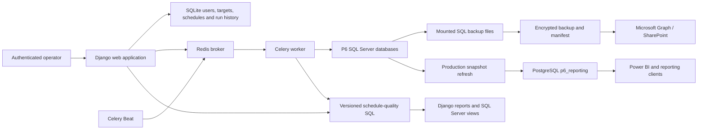

# P6BackupAdmin

P6BackupAdmin is the operations and reporting workspace for the Axial Primavera P6 environments. It brings together database backups and recovery, maintenance, schedule-quality checks, portfolio reports, and access to reporting data for Power BI.

The Django application manages AxialP6, Axial Training, and P62212 backup targets and reports from P6 data held in SQL Server. A separate production PostgreSQL reporting database combines snapshots from P6 22 and P6 23 for reporting clients. Django users, permissions, schedules, and operational history are stored in SQLite.

### The main parts

| Area | What it is for |
| --- | --- |
| Backup and recovery | Schedule encrypted SQL Server backups to SharePoint, review history and retention, and restore a selected backup. |
| Database maintenance | Review maintenance history and results, including index work, stale-session cleanup, log retention, and P6 user-data pruning. |
| Schedule Quality | Review programme scorecards and validation evidence, configure checks, and publish refreshed results. |
| Portfolio Reporting | Explore portfolio, milestone, risk, health, project, and resource reports. |
| Reporting Database | Use PostgreSQL snapshots, XERToolkit-compatible views, and Coding Check views as sources for Power BI and other reporting clients. |

**Repository scope:** this checkout contains the backup application and its SQL Server reporting assets. The production PostgreSQL mirror and its management module are not fully present in this repository. A GitHub checkout alone does not recreate the complete production reporting system; see [PostgreSQL reporting and Power BI](#postgresql-reporting-and-power-bi).

## What it does

- Runs native SQL Server `BACKUP DATABASE ... WITH CHECKSUM` operations.
- Encrypts backup files in chunks with Fernet before they leave the server.
- Generates manifests and SHA-256 checksums for backup verification.
- Uploads encrypted backups and manifests to SharePoint through Microsoft Graph.
- Applies per-target SharePoint retention policies.
- Restores backups with hash verification, decryption, `RESTORE VERIFYONLY`, `FILELISTONLY`, and explicit `WITH MOVE` paths.
- Schedules backup, restore, and schedule-quality work through Celery, Redis, and `django-celery-beat`.
- Provides database-maintenance operations and auditable run histories.
- Presents schedule-quality overview, validation, evidence, and configuration pages.
- Publishes versioned schedule-quality configuration and materialised results atomically in SQL Server.
- Exposes Power BI-compatible schedule-quality views and task-level evidence.
- Provides portfolio reports for milestones, schedule risk, health, projects, and resources.

## System overview



The backup workflow, SQL Server schedule-quality refresh, and PostgreSQL snapshot refresh serve different purposes and run independently. The PostgreSQL database is a reporting copy; it is not a replacement for a recoverable P6 backup.

### Components and responsibilities

| Component | Responsibility |
| --- | --- |
| Django web application | Authenticates users, enforces permissions, renders the workspace, accepts operational requests, and displays reports and run history. |
| SQLite | Stores Django users and groups, target configuration, schedules, and operational run records. It does not contain the P6 databases. |
| Celery worker and Redis | Queue and execute long-running backups, restores, schedule-quality refreshes and publications, and maintenance tasks. |
| Celery Beat | Dispatches recurring jobs using schedules held in Django's database. |
| P6 SQL Server | Holds the operational P6 data and the `powerbitables` schedule-quality configuration, materialised results and reporting views. |
| Microsoft Graph and SharePoint | Provide the destination for encrypted backup artifacts, manifests and retention; Graph can also send notifications. |
| PostgreSQL reporting service | Maintains separate published P6 snapshots and views for reporting consumers. Its complete runtime is maintained in production outside this checkout. |

For schedule quality, the application submits and monitors work, while SQL Server owns the rules and published results. The checked-in portfolio reports query the configured SQL Server reporting source. The production reporting module can also be configured to serve web reports from PostgreSQL; the active engine must be checked in that environment.

## Default backup targets

Running `bootstrap_p6_targets` creates the following target definitions:

| Target | Default database | Host port | Container backup mount | SharePoint folder |
| --- | --- | ---: | --- | --- |
| AxialP6 | `Axial` | `1466` | `/mnt/p6-backups/axialp6` | `P6 Backups/AxialP6` |
| Axial Training | `Axial_Training` | `1466` | `/mnt/p6-backups/axialp6` | `P6 Backups/Axial Training` |
| P62212 | `Axial` | `1433` | `/mnt/p6-backups/p62212` | `P6 Backups/P62212` |

Targets are created disabled, with no SQL password. Configure each target's connection and password in the application before enabling jobs. The target password is stored in the application database, so protect SQLite backups and access accordingly. SQL Server Express compression must remain disabled.

## Backup and restore lifecycle

SQL Server writes the original backup into its own `/var/backups` mount:

```sql
BACKUP DATABASE [DatabaseName]
TO DISK = N'/var/backups/target_backup_YYYYMMDD_HHMMSS.bak'
WITH INIT, CHECKSUM;
```

P6BackupAdmin then:

1. Finds the same file through the application-side mounted backup path.
2. Calculates the original SHA-256 checksum.
3. Encrypts the file in chunks using the first configured Fernet key.
4. Writes a manifest containing the hashes and backup metadata.
5. Uploads the encrypted backup and manifest to SharePoint.
6. Optionally verifies the uploaded content and removes local staging files.
7. Applies the configured SharePoint retention policy.

A restore reverses that flow. It downloads the encrypted artifact and manifest, verifies hashes, attempts decryption with the configured key ring, runs `RESTORE VERIFYONLY` and `RESTORE FILELISTONLY`, and restores the database using explicit data and log destinations.

> [!IMPORTANT]
> Keep every historical key required by retained backups in `BACKUP_ENCRYPTION_KEYS`. Losing a key makes backups encrypted with that key unrecoverable.

## Technology

- Python 3.12
- Django 5
- Server-rendered Django templates, CSS, JavaScript, and HTMX for the workspace
- Celery and `django-celery-beat`
- Redis 7
- Microsoft ODBC Driver 18 for SQL Server
- SQLite for application state
- SQL Server for P6 and schedule-quality data
- PostgreSQL for the separate production reporting snapshot
- Microsoft Graph for SharePoint and optional email delivery
- Docker Compose for the application stack

## Repository layout

| Path | Purpose |
| --- | --- |
| `backups/models.py`, `backups/forms.py` | Backup and operational state models, and schedule-quality settings forms |
| `backups/views.py`, `backups/urls.py` | Site pages, request handling, permission checks, and routes |
| `backups/navigation.py`, `backups/context_processors.py` | Permission-aware workspace navigation and shared template context |
| `backups/tasks.py` | Celery entry points for backups, restores, reporting refreshes, and maintenance |
| `backups/services/` | SQL Server, SharePoint, encryption, backup/restore, scheduling, maintenance, and reporting workflows |
| `backups/management/commands/` | Bootstrap, scheduling, backup, and permission commands |
| `backups/migrations/`, `backups/tests/` | Django schema changes and automated coverage |
| `backups/static/backups/` | Workspace styles, scripts, fonts and icons |
| `graph/` | Microsoft Graph token and email helpers |
| `p6_backup_admin/` | Django settings, URLs, WSGI, and Celery bootstrap |
| `docs/workspace-navigation.md` | Workspace navigation, permissions, and release notes |
| `sql/schedule_quality/` | Versioned SQL Server forward, verification, reconciliation, and rollback scripts |
| `templates/` | Shared shell, navigation, application pages, emails, authentication, and reports |
| `docker-compose.yml` | Web, Celery, Beat, Redis, volumes, ports, and external networks |
| `.env.example` | Safe environment-variable template |

Runtime databases, secrets, virtual environments, generated static files, deployment staging, rollback snapshots, and local QA captures are intentionally excluded from Git and Docker build contexts.

## Prerequisites

- Docker Desktop on Windows, or Docker Engine with the Compose plugin on Linux.
- Existing P6 SQL Server instances reachable from the application containers.
- Backup directories mounted into both SQL Server and P6BackupAdmin at their configured paths.
- The external Docker networks `AxialP6` and `p62212_default`.
- A Microsoft Entra application with appropriate Graph permissions when SharePoint upload or Graph email is enabled.

For a non-Docker development environment, install Python 3.12, Microsoft ODBC Driver 18, and the packages in `requirements.txt`.

## Configuration

Create the environment file from the committed template:

```bash
cp .env.example .env
```

Generate a Django secret and a Fernet encryption key rather than using development placeholders:

```bash
python -c "import secrets; print(secrets.token_urlsafe(64))"
python -c "from cryptography.fernet import Fernet; import json; print(json.dumps([Fernet.generate_key().decode()]))"
```

### Core settings

| Variable | Purpose | Typical/default value |
| --- | --- | --- |
| `DEBUG` | Django debug mode | `true` locally; `false` in production |
| `DJANGO_SECRET_KEY` | Django signing secret | Required in production |
| `ALLOWED_HOSTS` | Comma-separated hostnames/IPs | Local and deployed application hosts |
| `CSRF_TRUSTED_ORIGINS` | Comma-separated trusted origins | Full HTTP/HTTPS origins |
| `TIME_ZONE` | Django and Celery timezone | `Europe/London` |
| `SQLITE_PATH` | Application-state database path | `db.sqlite3` |
| `BACKUP_STAGING_ROOT` | Temporary backup working directory | `backup-temp` |
| `BACKUP_ENCRYPTION_KEYS` | JSON array of Fernet keys; first encrypts, all may decrypt | Required for real backup jobs |
| `BACKUP_KEEP_LOCAL` | Retain local encrypted artifacts | `false` |
| `BACKUP_VERIFY_SHAREPOINT_UPLOAD` | Download/verify uploaded artifacts | `false` |

### SQL Server settings

| Variable | Purpose | Default |
| --- | --- | --- |
| `P6_DEFAULT_SQL_HOST` | Default P6 SQL Server hostname | `host.docker.internal` |
| `P6_AXIALP6_SQL_PORT` | AxialP6 host port | `1466` |
| `P6_P62212_SQL_PORT` | P62212 host port | `1433` |
| `P6_P62212_SQL_PASSWORD` | Schedule-quality password fallback | No default |
| `P6_SCHEDULE_QUALITY_SQL_HOST` | Schedule-quality SQL host | `P6_DEFAULT_SQL_HOST` |
| `P6_SCHEDULE_QUALITY_SQL_PORT` | Schedule-quality SQL port | `P6_P62212_SQL_PORT` |
| `P6_SCHEDULE_QUALITY_SQL_DATABASE` | Reporting source database | `P62212_1` |
| `P6_SCHEDULE_QUALITY_SQL_USERNAME` | Reporting SQL login | `admin` |
| `P6_SCHEDULE_QUALITY_SQL_PASSWORD` | Reporting SQL password | Falls back to `P6_P62212_SQL_PASSWORD` |
| `P6_SCHEDULE_QUALITY_SQL_DRIVER` | ODBC driver name | `ODBC Driver 18 for SQL Server` |

### Scheduling and permissions

| Variable | Purpose | Default |
| --- | --- | --- |
| `P6_SCHEDULE_QUALITY_REFRESH_ENABLED` | Enables the Beat refresh task | `true` |
| `P6_SCHEDULE_QUALITY_REFRESH_SCHEDULE` | Five-part cron expression | `*/15 * * * *` |
| `P6_SCHEDULE_QUALITY_REFRESH_PROJ_ID` | Optional single-project scheduled refresh | All projects |
| `P6_SCHEDULE_QUALITY_PROFILE_CODE` | Active profile identifier | `default` |
| `P6_SCHEDULE_QUALITY_EDITOR_GROUP` | Django group allowed to edit/publish settings | `Schedule Quality Editors` |
| `P6_SCHEDULE_QUALITY_REPORT_GROUP` | Django group allowed to view schedule-quality reports | `ScheduleQuality` |
| `P6_PORTFOLIO_REPORTING_GROUP` | Django group allowed to view portfolio reports | `Portfolio Reporting` |

### Microsoft Graph and email

| Variable | Purpose |
| --- | --- |
| `GRAPH_TENANT_ID` | Microsoft Entra tenant ID |
| `GRAPH_CLIENT_ID` | Application/client ID |
| `GRAPH_CLIENT_SECRET` | Application secret |
| `GRAPH_MAIL_SENDER` | Mailbox used for Graph email |
| `EMAIL_BACKEND` | Django email backend |
| `EMAIL_HOST`, `EMAIL_PORT` | SMTP connection |
| `EMAIL_HOST_USER`, `EMAIL_HOST_PASSWORD` | SMTP credentials |
| `EMAIL_USE_TLS` | Enable SMTP TLS |
| `DEFAULT_FROM_EMAIL` | Default sender address |

Never commit `.env`, encryption keys, SQL passwords, Graph credentials, SQLite databases, or backup artifacts.

## Start with Docker Compose

The repository's Compose stack is intended for development: it bind-mounts the checkout and runs Django's development server. The production service uses a separate configuration described under Deployment.

Set the host backup paths before starting the stack.

Windows PowerShell:

```powershell
$env:P6_AXIALP6_BACKUPS_PATH = "C:/Dev/P6/AxialP6/backups"
$env:P6_P62212_BACKUPS_PATH = "C:/Dev/P6/P62212/backups"
docker compose up -d --build
```

Ubuntu:

```bash
export P6_AXIALP6_BACKUPS_PATH=/home/AxialP6/backups
export P6_P62212_BACKUPS_PATH=/home/mat/P62212/backups
docker compose up -d --build
```

Initialise the application:

```bash
docker compose exec -T web python manage.py migrate --noinput
docker compose exec -T web python manage.py bootstrap_p6_targets
docker compose exec -T web python manage.py sync_backup_schedules
docker compose exec -T web python manage.py sync_schedule_quality_refresh
docker compose exec web python manage.py createsuperuser
```

Open `http://localhost:8026/` and sign in with the created superuser.

## Site and navigation

After sign-in, Home provides entry points to the areas available to the user. The persistent icon rail opens each area; its contextual sidebar links to the pages in that area. Home has no secondary sidebar. The menu is built from the user's access, while each view applies its own permission checks.

Report pages provide filters for dimensions such as portfolio, project, lead planner, project status and state, discipline, phase, and update date. Apply the filter drawer to run a selection; cancelling restores the applied filters. Navigating within the same report area carries filters across pages. Changing area resets those filters while preserving a valid report-source selection when the installation supports source selection.

| Navigation area | Pages and purpose |
| --- | --- |
| **Home** | The signed-in landing page at `/`. |
| **Portfolio Reporting** | Overview, Milestones, Risk & float, Schedule health, Projects and Resources. Starts at `/portfolio-reporting/overview/`; the report hub is `/portfolio-reporting/`. |
| **Quality Reports** | Programme check at `/schedule-quality/overview/` and Validation & evidence at `/schedule-quality/validation/`. |
| **Operations** | Backup Targets at `/backup-targets/`, maintenance history at `/maintenance/`, and schedule-quality data refresh at `/schedule-quality/`. |
| **Quality Settings** | Shared quality rules and publication at `/schedule-quality/settings/`. |
| **Reporting Database** | Optional production module for reporting-source status, views, refresh history and authorised controls. It appears only when the module is installed and the user has access. |

### Portfolio Reporting

| Page | What it shows |
| --- | --- |
| Overview | Portfolio health, project status and projects requiring attention. |
| Milestones | Milestone delivery, upcoming dates and overdue exposure by project. |
| Risk & float | Total-float distribution and schedule-risk exposure. |
| Schedule health | Configured schedule-quality scores and health bands by project. |
| Projects | Progress, float, milestones and critical exposure for a selected project. |
| Resources | Planned, actual and remaining units from P6 resource assignments. |

### Quality Reports and Settings

Programme check presents project-level scorecards; Validation & evidence explains check results and associated task-level evidence. The Quality Settings page manages a shared draft of checks, scope, thresholds, scoring and evidence display. Publishing builds and activates the revised configuration and results together. The data-refresh page shows refresh history and provides a manual refresh and schedule controls to users with the relevant access.

### Operations and Reporting Database

Backup Targets shows target configuration, schedules and run history, with backup, remote artifact and restore workflows. Restore requires superuser access and a confirmation step. Maintenance history records the outcomes and details of database-maintenance work. Background tasks include index maintenance, session cleanup, log and user-data pruning, statistics and integrity checks.

Where installed in production, Reporting Database shows source freshness and publication status, view previews and refresh history. Authorised users can request a refresh; staff can access additional settings and reporting-engine comparison. The complete module is not included in this checkout.

Authentication is required for operational pages. Backup and maintenance administration requires staff access. Schedule-quality overview and validation reports require membership of the configured report group; portfolio reports require membership of their separate report group. These report permissions require group membership even for a superuser. Schedule-quality settings and schedule editing require staff access or membership of the configured editor group. See [`docs/workspace-navigation.md`](docs/workspace-navigation.md) for workspace navigation and permission details.

Grant an existing Django user editor access:

```bash
docker compose exec -T web python manage.py grant_schedule_quality_editor USERNAME
```

Grant access to the two report areas separately, including for superusers who need to view them:

```bash
docker compose exec -T web python manage.py grant_schedule_quality_report_access USERNAME
docker compose exec -T web python manage.py grant_portfolio_reporting_access USERNAME
```

## Useful management commands

```bash
# Create missing default targets
python manage.py bootstrap_p6_targets

# Also refresh connection/path defaults on existing targets
python manage.py bootstrap_p6_targets --update-existing

# Synchronise Celery Beat jobs from target schedules
python manage.py sync_backup_schedules

# Synchronise the schedule-quality Beat job from environment settings
python manage.py sync_schedule_quality_refresh

# Run one target immediately
python manage.py run_p6_backup p62212

# Allow a disabled target to run explicitly
python manage.py run_p6_backup p62212 --force

# Grant schedule-quality editor membership
python manage.py grant_schedule_quality_editor USERNAME
```

Prefix these commands with `docker compose exec -T web` when operating the Compose deployment.

## Schedule-quality reporting

Schedule-quality configuration and materialised reporting data are owned by SQL Server under the `powerbitables` schema. Django provides the authenticated editor, publisher, refresh controls, and report surfaces; it is not a second copy of the rules.

Editors work on a shared draft. Publication stages a complete rebuild using that draft and activates the configuration and materialised rows only after the full stage succeeds. A failed publication leaves the previously active configuration and results in place.

The SQL package includes:

- pre-deployment snapshots;
- versioned forward scripts;
- post-deployment assertions;
- canary and full-refresh support;
- project/task evidence views for Power BI;
- full reconciliation queries;
- targeted and full rollback scripts.

Read [`sql/schedule_quality/README.md`](sql/schedule_quality/README.md) before applying SQL assets. The scripts contain `GO` separators and require a GO-aware runner that keeps a single SQL connection open across batches. Always validate against a restored database first, take the documented snapshot, run every post-deployment assertion, use a canary project, and reconcile immediately after the full refresh while P6 imports are paused.

## Portfolio reporting

The checked-in portfolio reporting pages use the configured schedule-quality SQL Server connection and `powerbitables` reporting views. Access is controlled independently from schedule-quality reports by `P6_PORTFOLIO_REPORTING_GROUP`. Production may use the optional PostgreSQL reporting engine when configured.

## PostgreSQL reporting and Power BI

The production reporting service copies data from the P6 22 and P6 23 SQL Server sources into the separate `p6_reporting` PostgreSQL database. It exposes source-specific and combined reporting views, including XERToolkit-compatible views, so reporting clients can query a published snapshot rather than the live P6 databases. Source identifiers matter when combining data: project and activity IDs can overlap between P6 systems.

The reporting snapshot has its own refresh process, separate from both SharePoint backups and the temporary IONOS recovery-continuity export. The last documented verification on 29 October 2026 found the hourly reporting refresh enabled without an expiry; check the reporting service and its latest refresh before relying on current data. Snapshot time and refresh status matter when interpreting any report.

External clients connect to `p6operations.axialprojects.com` on port `5432`, database `p6_reporting`, using an authorised reporting account and TLS with `sslmode=verify-full`. Obtain credentials and the trusted CA configuration privately. A Power BI model must refresh its data and metadata to reflect changes to source views.

### Coding Check views

Eight `reporting.coding_check_*` PostgreSQL views support the Coding Check dashboard. They cover Global Project Stage, Discipline, Design Key, Milestone Type and Responsible Company, plus activity-code counts and float/path summaries. They were deployed and verified on 29 October 2026; the public views are restricted to **P6 22**, Live and Client Submitted programmes, excluding deleted activities. They retain `_snapshot_at` and use grouped counts rather than individual task rows. Missing or unassigned codes are represented as uncoded; the source data can contain gaps.

The combined reporting database still contains both P6 sources, so select P6 22 explicitly when joining the coding views to combined data. Refresh Power BI metadata after the view-column changes and update any query steps that refer to removed columns. The local Coding Check SQL package and the production reporting-mirror implementation are not currently included in this GitHub checkout; use the separately retained production release assets and their verification instructions when maintaining them.

## Validation and tests

Run the Django configuration and migration checks:

```bash
docker compose exec -T web python manage.py check
docker compose exec -T web python manage.py makemigrations --check --dry-run
```

Run the full Django test suite:

```bash
docker compose exec -T web python manage.py collectstatic --noinput
docker compose exec -T web python manage.py test
```

Focused schedule-quality coverage:

```bash
docker compose exec -T web python manage.py test \
  backups.tests.test_schedule_quality_reporting \
  backups.tests.test_schedule_quality_sql_assets
```

For an isolated image check without a running Compose stack:

```bash
docker build -t p6backupadmin-check .
docker run --rm p6backupadmin-check python manage.py check
docker run --rm p6backupadmin-check python manage.py test
```

## Deployment

The current production service on `XPS-Server-4` uses the bind-mounted application
at `/home/mat/Docker/P6-Standby/app`. It is not a Git checkout. The Compose project
is `p6-standby`, configured by `/home/mat/Docker/P6-Standby/compose.json`; private
configuration remains outside the application directory. The web container is
`p6-backup-admin-web`, serving `p6operations.axialprojects.com`. Use this hostname
in `ALLOWED_HOSTS` and its HTTPS origin in `CSRF_TRUSTED_ORIGINS`. External
PostgreSQL reporting clients use `p6operations.axialprojects.com:5432` with
`sslmode=verify-full`.
The public site is `https://p6operations.axialprojects.com`.

For a presentation-only release, deploy an explicit file manifest from the tested
`main` commit. Compare the affected live files with the preflight hashes, save a
timestamped rollback copy, and preserve production-only backend modules and
report templates. Then run:

```bash
docker exec p6-backup-admin-web python manage.py check
docker exec p6-backup-admin-web python manage.py collectstatic --noinput
docker restart p6-backup-admin-web
```

Before a deployment:

1. Confirm the local and GitHub commit IDs and record the deployed file hashes.
2. Compare the live application with the release manifest; reconcile differences before replacing files.
3. Preserve `.env`, SQLite state, and any files affected by the release in a timestamped rollback location.
4. Back up data stores before migrations or SQL deployments.
5. Validate the candidate image before restarting services.

After deployment, rerun checks/tests appropriate to the change, inspect container status/logs, and verify the authenticated application paths. Do not treat a successful HTTP redirect alone as full acceptance.

## Rollback and recovery

- Application rollback: restore the timestamped copies of the affected files, regenerate collected static assets, and restart the affected service. For image releases, restore the recorded previous image.
- Django state: restore the pre-deployment SQLite backup when a migration must be reversed through data recovery.
- Schedule-quality SQL: use only the rollback script paired with the deployed forward change and its required snapshot.
- Encrypted backups: retain old Fernet keys until no retained artifact depends on them.
- SQL restore: keep the manifest with its encrypted backup; both are required for integrity verification.

Never perform an application rollback by deleting the production directory or overwriting `.env` and runtime databases from Git.

## Security notes

- `.env` and its production variants are ignored by Git and Docker.
- Docker build context excludes databases, credentials, staging files, rollback snapshots, generated static files, and local QA artifacts.
- Backup encryption happens before SharePoint upload.
- Restore verifies both encrypted and decrypted content against the manifest.
- Operational routes require Django authentication and CSRF protection.
- Use `DEBUG=false`, a unique `DJANGO_SECRET_KEY`, explicit trusted hosts/origins, and least-privilege Graph permissions in production.
- Rotate Graph and reporting SQL credentials through private configuration. Backup target SQL passwords are maintained in the application and stored in its SQLite database.
- Test backup restoration regularly; an untested backup is not a proven recovery path.

## Git workflow

Keep commits focused, run the relevant checks before pushing, and never add runtime state or secrets to a commit. The current bind-mounted production directory requires an explicit deployment manifest; a GitHub push alone does not deploy it. This checkout does not contain every production component, so reconcile production-only source differences before moving to a complete image or checkout-based deployment.

## Licence and support

No open-source licence has been granted in this repository. Unless a licence is added, the code remains all rights reserved. Operational ownership, deployment access, SQL credentials, encryption keys, and Microsoft Graph configuration are managed privately by the project owner.
